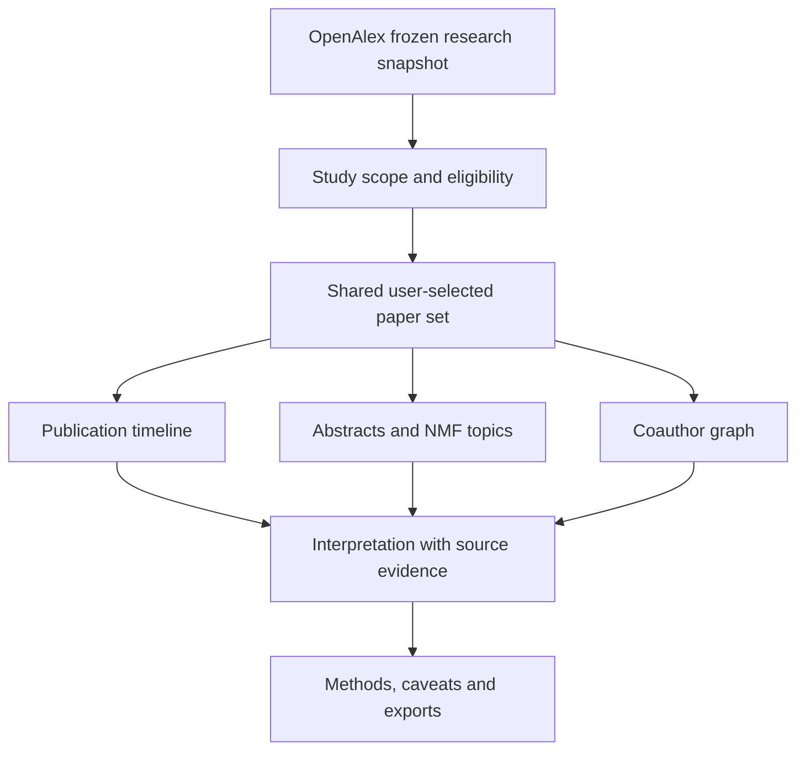

<div align="center">

# 🩺 Clinical AI Research Atlas

### Mapping the evolution, language, and collaboration networks of trustworthy clinical AI research

**An interactive, evidence-linked research explorer built with real OpenAlex records (2016–2025).**

[](https://clinical-ai-research-atlas.streamlit.app/)
[](app.py)
[](docs/METHODOLOGY.md)


[**🚀 Launch Atlas**](https://clinical-ai-research-atlas.streamlit.app/) · [**📚 Research methods**](docs/METHODOLOGY.md) · [**🧪 QA & testing**](docs/QA.md) · [**📊 Data audit**](docs/DATA_AUDIT.md)

</div>

---

## The research question

> **Within a search-defined corpus of clinical prediction and decision-support research, how do trustworthiness-related language, publication activity, and coauthorship patterns vary across 2016–2025?**

Clinical AI research is often summarized with a single number: papers published, a topic frequency, or a central author. Each view tells only part of the story.

**Clinical AI Research Atlas connects three complementary data modalities**—publication timelines, scientific text, and coauthor relationships—so that researchers can inspect the evidence behind patterns instead of relying on isolated charts.

This is **exploratory research analytics**, not a systematic review or a clinical performance evaluation.

### Project at a glance

| Research dimension | Source / implementation |
|:--|:--|
| **Research corpus** | OpenAlex, search-defined 2016–2025 snapshot |
| **Selected works** | **1,395** |
| **Text-eligible works** | **1,209** |
| **Network-eligible works** | **1,352** |
| **Identified authors** | **6,464** |
| **Core modalities** | Time-series · Text/NMF · Coauthorship network |
| **Interface** | 5-tab Streamlit research application |
| **Analytical libraries** | Pandas · NumPy · scikit-learn · Plotly · NetworkX · PyVis |
| **Provenance** | Retrieval manifest, frozen processed files and documented methods |
| **Interpretation** | Descriptive; human relevance/topic review remains to be completed |

*Numbers describe the bundled study snapshot, not all clinical AI literature or a live OpenAlex census. Eligibility denominators differ by visualization.*

---

## Explore the Atlas

**[▶ Open the interactive research dashboard](https://clinical-ai-research-atlas.streamlit.app/)**

Use shared filters to select a publication period, research signal, topic, or search term. Then move between research language, collaboration structure, and source-paper evidence.

| Workspace | Question it helps answer | Exploration |
|:--|:--|:--|
| **01 · Overview** | Which works are represented? | Corpus summary, coverage, selected papers |
| **02 · Research Evolution** | How do publication activity and signals change over time? | Annual counts, overlapping trustworthiness signals, denominators |
| **03 · Research Language** | What do selected abstracts discuss? | Term frequency, fixed NMF topics, paper/abstract inspection |
| **04 · Collaboration Network** | Which authors are connected in this corpus? | Animated or fixed networks, author focus, community structure, adjacency matrix |
| **05 · Synthesis & Methods** | What can—and cannot—be concluded? | Methodology, provenance, eligibility, limitations, exports |

<details>
<summary><strong>▶ Try this guided exploration</strong></summary>

1. **Start broad:** open *Overview* and note the selected-work count and eligible populations.
2. **Narrow the corpus:** choose a year range, a trustworthiness signal, or a research term in the shared controls.
3. **Compare evolution:** use *Research Evolution* to see how counts and signal shares change; inspect denominators before interpreting small years.
4. **Inspect language:** open *Research Language*, compare term frequencies and NMF themes, then read representative source records.
5. **Explore collaboration:** open *Collaboration Network*, change the shared-paper threshold and layout, and inspect author or author-pair evidence.
6. **Check interpretation:** open *Synthesis & Methods* for provenance, selection limitations, and available filtered exports.
7. **Reset with care:** confirm the filters, chips, selected record counts, and charts return to the intended default state after a reset.

**Interaction note:** Not every animated chart is a clickable cross-filter. Sidebar controls and evidence selectors are the reliable primary selection paths; see current UI guidance for supported interactions.

</details>

---

## Three modalities, one research population

<table>
<tr>
<td width="33%" valign="top">

### 📈 Research evolution

Explore annual publication counts, time coverage, and overlapping trustworthiness-signal shares.

**Reading rule:** a rise in search results is not automatically a rise in all clinical AI research.

</td>
<td width="33%" valign="top">

### 🧠 Research language

Compare document-frequency terms, interpretable NMF themes, and underlying abstracts.

**Reading rule:** topic weights and algorithmic labels are not probabilities or human-validated conclusions.

</td>
<td width="33%" valign="top">

### 🕸 Collaboration structure

Explore coauthor edges, communities, centrality, thresholds, layouts, and adjacency matrices.

**Reading rule:** observed connectivity does not establish scientific influence, friendship, or clinical impact.

</td>
</tr>
</table>

### How the modalities connect



The project uses a **shared analytical selection** while applying explicit text and graph eligibility rules. A paper can appear in the overall corpus without contributing to every modality.

<details>
<summary><strong>▶ Why the denominators differ</strong></summary>

The main population contains **1,395 selected works**. Text-specific views require eligible text and therefore use **1,209 text-eligible works**. Network analyses require usable authorship metadata and therefore use **1,352 network-eligible works**.

These are **different analytical subsets**, not contradictory totals. Inspect the numerator, denominator, filter state and missing-data rules together when reporting a result.

</details>

---

## Analytical design

### 01 · Publication activity and trustworthiness signals

Annual counts and signal-share trends help examine how the *selected corpus* changes from 2016 through 2025. Signals can overlap: a paper may discuss multiple concepts such as calibration, explainability, interpretability, or uncertainty. Shares should not be summed as mutually exclusive categories.

<details>
<summary><strong>▶ What a publication trend does—and does not—measure</strong></summary>

The source is a query-defined OpenAlex snapshot. Changes in indexing, search language, eligibility, source types and coverage can change the observed yearly totals.

The repository includes a dedicated [2025 spike audit](docs/2025_SPIKE_AUDIT.md). Read it before interpreting the apparent increase in retrieved papers as a field-wide research trend.

</details>

### 02 · Scientific text and NMF themes

The language explorer combines transparent term frequencies with **non-negative matrix factorization (NMF)** topic assignments.

- Document-frequency bars indicate how many eligible documents contain a term, not necessarily how often the token appears.
- Topic labels are interpretive descriptions of statistical patterns, pending human review.
- Original paper titles, abstracts and source links provide a way to inspect topic assignments.
- Topic evaluation material is documented rather than presented as independent scientific validation.

<details>
<summary><strong>▶ How to interpret a topic bubble</strong></summary>

A visually large circle indicates a greater quantity under the displayed topic-size encoding. Its position and proximity need not encode semantic distance unless explicitly documented.

Compare the circle with its exact-count legend and supporting papers. Small or visually compelling clusters are not automatically clinically meaningful.

</details>

### 03 · Coauthor communities and network evidence

NetworkX and PyVis support exploration of researcher relationships derived from **shared authored works** in the selected study corpus.

| Visual encoding / measure | Interpretation |
|:--|:--|
| **Node** | Author identified in eligible work metadata |
| **Edge** | Observed coauthorship relationship |
| **Edge weight / shared-paper threshold** | Repeated coauthorship strength in this corpus |
| **Node size / strength** | Selected structural metric (check view-specific legend) |
| **Color** | Detected graph community or grouping |
| **Force-directed layout** | Interactive structural overview, not geographical position |
| **Adjacency matrix** | Pairwise connection structure without edge overlap |
| **Author-pair evidence** | The paper records underlying a selected connection |

<details>
<summary><strong>▶ Broad and repeated-collaboration views</strong></summary>

A network including authors with **at least one shared paper** differs substantially from a stricter network requiring **at least two shared papers**. Compare the displayed threshold, sample cap, node count and edge count before drawing conclusions.

Algorithmically detected communities describe patterns of connections in the displayed graph. They do **not** establish real organizational groups or individual research quality.

</details>

---

## Reproducibility and data provenance

The project preserves processed study data and documents its retrieval scope. Core reproducibility resources include:

| Resource | Purpose |
|:--|:--|
| [`configs/study_scope.json`](configs/study_scope.json) | Search scope, eligible types, dates and seeds |
| [`data/processed/retrieval_manifest.json`](data/processed/retrieval_manifest.json) | Data retrieval/provenance |
| [`data/processed/works.jsonl`](data/processed/works.jsonl) | Bundled processed work-level records |
| [`docs/DATA_AUDIT.md`](docs/DATA_AUDIT.md) | Quality and scope review |
| [`docs/METHODOLOGY.md`](docs/METHODOLOGY.md) | Selection, features and analytical definitions |
| [`docs/REVIEW_PROTOCOL.md`](docs/REVIEW_PROTOCOL.md) | Human review process |
| [`docs/ACCEPTANCE_MATRIX.md`](docs/ACCEPTANCE_MATRIX.md) | Verification and remaining acceptance criteria |

The original retrieval query and exact study choices are documented in the linked configuration and manifest. A **new OpenAlex search is not identical to reproducing the frozen snapshot**.

<details>
<summary><strong>▶ Rebuild the processed study outputs</strong></summary>

Where the frozen raw snapshot is available locally:

```bash
python scripts/build_outputs.py --snapshot data/raw/snapshot_final_20261022
```

Do not overwrite completed manual-review sheets. Preserve them separately before rebuilding, as described in the repository's original setup documentation and review protocol.

To retrieve a newly dated snapshot:

```bash
python scripts/fetch_openalex.py --output data/raw/snapshot_NEW_DATE
python scripts/build_outputs.py --snapshot data/raw/snapshot_NEW_DATE
```

OpenAlex API requirements and search results can change. Store secrets in environment variables rather than the repository.

</details>

---

## Run locally

**Recommended:** Python 3.12 in a clean virtual environment.

```bash
git clone https://github.com/nazishatta/clinical-ai-research-atlas.git
cd clinical-ai-research-atlas

python3.12 -m venv .venv
source .venv/bin/activate

python -m pip install --upgrade pip
python -m pip install -r requirements.txt
python -m streamlit run app.py
```

Open **http://localhost:8501** (or the URL printed by Streamlit).

<details>
<summary><strong>▶ Windows setup</strong></summary>

```powershell
git clone https://github.com/nazishatta/clinical-ai-research-atlas.git
cd clinical-ai-research-atlas
py -3.12 -m venv .venv
.venv\Scripts\Activate.ps1
python -m pip install -r requirements.txt
python -m streamlit run app.py
```

</details>

### Run tests

```bash
python -m pip install -r requirements-dev.txt
python -m pytest -q
```

**Test status:** 34 passed on Python 3.13 with the pinned requirements (see [`docs/test_results.txt`](docs/test_results.txt)). The earlier 14 passed / 1 failed run no longer reproduces.

The reset defect was only visible in a real browser, so it also has a browser check. With the app running locally:

```bash
npm install playwright   # once
node tests/browser/reset_browser.cjs http://localhost:8501
```

It selects a topic, presses **Reset all filters**, moves the year slider, and prints the selected-works count and topic box after each step. After reset the topic box must read "All topics" and stay that way.

---

## Project structure

<details open>
<summary><strong>▶ Expand repository structure</strong></summary>

```text
clinical-ai-research-atlas/
├── app.py                       # Streamlit interface
├── src/
│   ├── analysis.py              # Research analysis
│   ├── evidence.py              # Source/evidence logic
│   ├── motion.py                # Animated plots
│   ├── topic_bubbles.py         # NMF topic circles
│   ├── live_network.py          # Interactive PyVis network
│   ├── clustered_network.py     # Network cluster views
│   └── dense_clusters.py        # Additional cluster layout
├── configs/
│   └── study_scope.json
├── data/
│   └── processed/               # Prepared analytical outputs
├── docs/                        # Methods, QA, reviews, deployment
├── scripts/                     # Fetch, build and validation scripts
├── tests/                       # Automated tests
├── validation/                  # Validation evidence
├── .streamlit/
│   └── config.toml
├── requirements.txt
└── README.md
```

</details>

---

## Visualization integrity, accessibility and limitations

This Atlas intentionally distinguishes **analytical patterns** from **independent scientific conclusions**.

**Interpretation safeguards**

- Search-based selection limits generalization to the entire clinical AI literature.
- Eligibility requirements differ for text, network and total-paper views.
- A publication result is not proof of peer review or clinical effectiveness.
- NMF topics require human inspection before substantive interpretation.
- Network communities and centrality are structural patterns, not validated influence scores.
- Counts, filters and source papers must accompany any claim about trends.
- Review sheets and independent coverage assessment remain part of the research validation workflow.

**Accessibility considerations**

- **Colour-blind-safe palette:** Okabe-Ito colours reordered for the dark theme ([`src/palette.py`](src/palette.py)). Every series colour has at least 3:1 contrast with the chart background; under simulated protanopia, deuteranopia and tritanopia the closest pair of the first six colours stays at CIE76 ΔE ≥ 16. The previous pastel palette dropped to ΔE 4.3 under deuteranopia.
- **Not colour alone:** dash styles on signal lines, fill patterns on topic bars, marker shapes on communities, hover values and data tables.
- **Alt text:** every embedded or animated chart has alt text, and every chart has an "In short" sentence generated from the numbers it draws ([`src/summaries.py`](src/summaries.py)).
- **Consistent encoding:** each topic keeps one colour in every topic chart.
- **Text alternatives:** an "Accessible data table" under each chart; keyboard-operable selectors and relationship tables for the networks.

Full keyboard, mobile, reduced-motion and screen-reader behavior still require systematic verification. Consult [`docs/QA.md`](docs/QA.md).

**Current quality status**

The app has been opened and interacted with in a deployed-browser review. That review identified reset-state synchronization, some clipped labels, animation-control wording and network label crowding. **Reset-state synchronization is fixed** (Reset now assigns widget defaults instead of deleting keys; covered by `tests/test_state.py` and the browser check above). The other findings remain open.

<details>
<summary><strong>▶ Known validation work before a stronger research claim</strong></summary>

1. Complete human relevance screening and an independent literature-coverage benchmark.
2. Review representative NMF topic documents and interpret the resulting labels.
3. Reconcile the 2025 trend with indexing/source and eligibility checks.
4. Verify linked paper and author evidence after filtering and reset interactions.
5. Complete browser accessibility, small-screen and reduced-motion testing.
6. Re-run clean-install and automated tests for the precise published commit.

See [`docs/RELEASE_STATUS.md`](docs/RELEASE_STATUS.md), [`docs/REVIEW_PROTOCOL.md`](docs/REVIEW_PROTOCOL.md) and [`docs/QA.md`](docs/QA.md).

</details>

---

## Built with

| Technology | Role |
|:--|:--|
| **Python** | Processing and application logic |
| **Streamlit** | Multi-tab web UI, filters, cached computation |
| **Pandas / NumPy** | Data preparation and summary analysis |
| **scikit-learn** | NMF text-topic modeling and related analysis |
| **Plotly** | Interactive research and temporal charts |
| **NetworkX** | Coauthorship graphs and structural analysis |
| **PyVis** | Dynamic network exploration |
| **OpenAlex** | Research metadata source |
| **Pytest** | Automated regression tests |
| **GitHub / Streamlit Community Cloud** | Version control and hosted application |

---

## Attribution, ethics and license

**Research metadata:** [OpenAlex](https://openalex.org/). The data snapshot and retrieval scope are documented in the [manifest](data/processed/retrieval_manifest.json). OpenAlex metadata is generally released under CC0; third-party publication content, including some abstracts, can retain separate rights.

**Responsible use:** This project is for studying research patterns, not making medical decisions or ranking researchers by scientific worth.

**AI assistance:** AI tools assisted with code, documentation and checking workflows. The project author remains responsible for research design, inspection of evidence, conclusions and compliance with applicable course disclosure policies.

**Code license:** [MIT](LICENSE). The code license does not relicense third-party research content.

---

## Author

**Nazish Atta** · Data Science · Research Analytics · Interactive Visualization

[GitHub Profile](https://github.com/nazishatta) · [Project Repository](https://github.com/nazishatta/clinical-ai-research-atlas) · [Live Atlas](https://clinical-ai-research-atlas.streamlit.app/)

<div align="center">

---

### Explore the publications. Inspect the language. Follow the evidence.

[](https://clinical-ai-research-atlas.streamlit.app/)

<sub>Real OpenAlex data · Three modalities · Explicit research limitations</sub>

</div>
